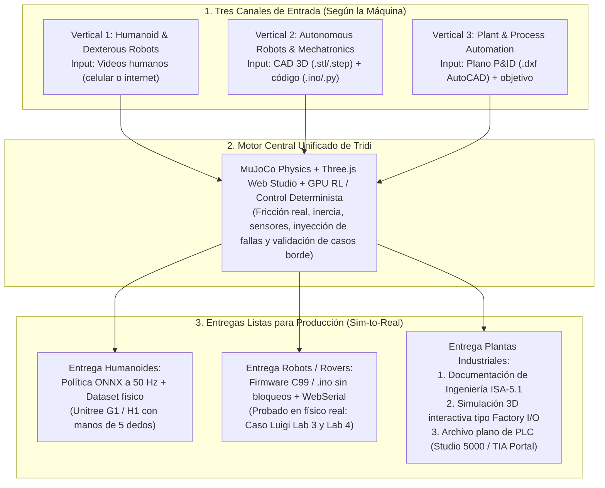

# Plan v4 — Resumen de Reunión ZAKA, Tesis de 3 Verticales y Next Steps (13 de Noviembre de 2026)

> **Para:** Juan, Pastor, César y Ale (y sus agentes de IA: Claude Code / Antigravity / Cursor)  
> **Contexto:** Conclusiones tras las **2 horas de reunión con el Ing. José González (ZAKA, C.A.)** (transcripción completa de 4.601 líneas procesada con Whisper local), análisis arquitectónico del repo ganador de Platanus Hack 26 (**`mus3o`**) y definición estratégica de cómo escalar Tridi sin encasillarnos ni afectar la aplicación activa a **Y Combinator W27** (`tridi-alpha.vercel.app` / `trytridi.com`).

---

## 1. Resumen Ejecutivo de la Reunión con el Ing. José González (ZAKA, C.A.)

Tuvimos una sesión de casi 2 horas donde el Ing. José González (~30 años automatizando plantas en Venezuela, integrador de **Rockwell Automation**, **Siemens** y **AVEVA**) nos explicó de punta a punta cómo opera la automatización industrial real (procesos continuos vs. discontinuos/por lotes, pirámide de automatización **ISA** niveles 0–4: Campo → PLC → SCADA → MES → ERP + capa consumidor/Industria 4.0, y convergencia OT/IT).

### Qué validamos al mostrarle Tridi (`luigi_lab3/lab4` + `factory_cell`)
1. **Le gustó y lo entendió de inmediato:** Vio totalmente viable integrar simulación física y redes neuronales en el flujo de trabajo de los integradores industriales.
2. **Dónde está el dolor real hoy (meses antes de tirar código):** Nos mostró un proyecto real en curso (22 silos de Harina PAN con tamizadores, tornillos sin fin y 6 empaquetadoras) y explicó que **pasan semanas o meses haciendo ingeniería conceptual/básica y redactando documentación antes de escribir la primera línea de código del PLC**.
3. **El producto exacto que él usaría y pagaría (en orden estricto de prioridad 1 → 2 → 3):**
   Todo parte de un único archivo estándar mundial que entrega el proyectista en AutoCAD: el **P&ID (*Piping & Instrumentation Diagram* / Diagrama de Tuberías e Instrumentación, en formato `.dxf` / `.dwg`)** más una descripción breve del proceso:
   - **Prioridad 1 — De archivo P&ID (`.dxf`) a Documentación Completa de Implementación (`ISA-5.1` / `ISA-88`):** Desglosar automáticamente el plano P&ID y generar la memoria descriptiva, filosofía de operación paso a paso, listado maestro de tags/instrumentación (`DI/DO/AI/AO`) y matriz de fallas. **Regla interna nuestra:** no esperamos ni dependemos de que nadie nos pase plantillas; armamos nuestra propia plantilla maestra 100 % basada en los estándares públicos de **`isa.org`**.
   - **Prioridad 2 — De archivo P&ID a Simulación Física 3D Custom (Estilo *Factory I/O*, pero auto-generada en la web):** Que al subir el P&ID se arme automáticamente la escena 3D interactiva del proceso (tanques, silos, válvulas, motores, cintas, sensores) en nuestro motor MuJoCo/Three.js, tanto para que el ingeniero **vea visualmente su planta funcionando y pruebe fallos** como para que la red neuronal optimice combinaciones (ej. $22 \times 22$ rutas de recirculación de silos) en milisegundos.
   - **Prioridad 3 (El Plus Hiper Genial) — Entrega del Archivo Final Instalable en el PLC:** Exportar el programa en archivo de texto plano (que él mismo usa en `Rockwell Studio 5000` `.L5K`/`.L5X`, `Siemens TIA Portal` `.scl`, `Schneider EcoStruxure` o `Logo!Soft Comfort`) armado con **bloques modulares tipo "Lego"** (arranque, parada, estatus, falla y horómetro de mantenimiento para cada motor/válvula).
4. **Mercado y Modelo de Negocio recomendado por él:**
   - **Primer cliente meta:** **Integradores de automatización** y **empresas normalizadas** bajo estándares ISA en Venezuela, Colombia, Chile y global.
   - **Por qué Venezuela es buen mercado inicial:** A diferencia de otros países de LatAm que dejan equipos de los años 80 sin tocar, las plantas grandes en Venezuela invierten activamente contra la obsolescencia para evitar paradas de planta.
   - **Modelo de cobro:** **Cloud SaaS *Pay-per-Compute* (pago por cómputo/proyecto subido en la nube)** en vez de licencias caras instaladas.
   - **Idioma técnico:** Todo nuestro entrenamiento, diccionarios ISA y prompts deben manejarse **100 % en inglés técnico industrial** (`isa.org`).

---

## 2. La Tesis Unificada de Tridi: 1 Solo Motor Físico, Múltiples Verticales (Sin Encasillarnos)

**No vamos a matar Humanoides ni vamos a encasillar a Tridi como "solo fábricas".**  
Además, dividir en "Humanoides vs. Industrial" era impreciso porque un humanoide o un rover también pueden trabajar dentro de una industria.

La definición correcta que mantiene a Tridi abierto a cualquier máquina física es:
> **Tridi es una sola plataforma de Physical AI y Gemelos Físicos en MuJoCo.** Cualquier máquina física tiene estructura/física, sensores (inputs) y actuadores/controlador (outputs). Tridi recibe el diseño o demostración del sistema, lo simula y entrena en física real, y entrega la documentación y el código de control listo para producción.

Hoy atacamos **3 verticales claras** sobre el mismo motor (y mañana podemos abrir más sin cambiar la arquitectura):



### Por qué esta estructura nos da lo mejor de los dos mundos:
- **De cara a Y Combinator (decisión W27 hasta el 11 de diciembre + los 4 batches trimestrales de 2027) y Casa 212 (Vicente Zavarce, diciembre 2026):** Mantenemos la visión gigante de **Physical AI & Humanoid Robotics** con la que aplicamos, respaldada ahora por transferencia Sim-to-Real real en hardware físico (`Luigi`) y tracción B2B industrial real (`ZAKA`).
- **De cara a monetizar rápido desde Venezuela hacia LatAm:** Las verticales 2 y 3 nos permiten cobrar ya mismo a integradores industriales, fábricas y laboratorios locales sin esperar a tener un humanoide de USD 16.000 en la oficina.

---

## 3. Plan de Ingeniería de `Tridi Industrial` (Inspirado en la Arquitectura de `mus3o`)

Analizamos a fondo el código de **`mus3o`** (ganadores de Platanus Hack 26, clonado en `~/Code/platanus-hack-26-ve-team-5`). Su arquitectura se basa en una regla de oro que aplicaremos directo en Tridi: **"La IA razona y el código ensambla"**:
- En `mus3o`, la IA **jamás escribe geometría 3D ni JSONs gigantes** (que alucinan y cuestan >10.000 tokens). La IA emite un **Micro-DSL de ~1.800 tokens** que solo puede elegir piezas de un **catálogo cerrado de primitivas 3D**, validado con esquema estricto (`Zod` con `.catch()` para que un error nunca tumbe la escena) y con un verificador mecánico (`verifySources`) que comprueba que cada elemento exista literalmente en el archivo subido por el usuario.

### Las 4 Etapas Técnicas que vamos a construir (De menos a más, cero *slop*)

#### Etapa 1 — Diccionario Oficial `ISA-5.1` en Inglés y Planos `.dxf` de Prueba (100 % de nuestro lado)
1. Codificar en `physics/components/isa_standard.json` la tabla completa de simbología e identificación **`ISA-5.1`** en inglés:
   - Letras de variable medida (`F` Flow, `L` Level, `P` Pressure, `T` Temperature, `W` Weight, `A` Analysis, `S` Speed/Frequency) + funciones (`I` Indicator, `T` Transmitter, `S` Switch, `V` Valve, `C` Controller, `H`/`L` High/Low; ej. `LSH` = *Level Switch High*, `FV` = *Flow Control Valve*, `WT` = *Weight Transmitter*).
   - Símbolos de equipos mecánicos (tanques atmosféricos, silos con tolva, bombas centrífugas, agitadores/mezcladores, tornillos sin fin *screw conveyors*, cintas y empaquetadoras).
2. Crear en `data/pid_samples/` nuestros propios planos P&ID en formato `.dxf` de AutoCAD empezando de menos a más:
   - **Caso Base 1 (`01_batch_mixer.dxf`):** El proceso por lotes que dibujó José en la reunión (tanque mezclador con 3 válvulas de ingredientes `FV-101..103`, balanza/celda de carga `WT-101`, motor agitador `M-101`, sensores de nivel `LSH-101`/`LSL-101` y válvula de descarga `FV-104`).
   - **Caso Base 2 (`02_silo_packaging.dxf`):** Batería de silos con tornillo sin fin, tamizador y descarga a empaquetadoras.

#### Etapa 2 — Prioridad #1: De `.dxf` P&ID a Documentación de Ingeniería ISA (`data/pid_parser.py` + `data/pid_docs.py`)
1. **Parser determinista `.dxf`:** Lee directamente el texto del archivo `.dxf` (`INSERT` bloques, `LWPOLYLINE` tuberías, `TEXT`/`MTEXT` tags `ISA-5.1`) y construye el **Grafo Dirigido del Proceso (DAG)** sin inventar un solo componente.
2. **Generador de Documentación (`Functional Design Specification — FDS`):** Produce automáticamente el documento formal de ingeniería (en Markdown y exportable a PDF/DOCX) con:
   - **1. Process Overview & Equipment Schedule** (equipos principales y función).
   - **2. ISA-5.1 Instrument & PLC I/O Schedule** (tabla completa de tags `DI`, `DO`, `AI 4-20mA`, `AO` y estado *fail-safe*).
   - **3. Step-by-Step Control Narrative** (filosofía de operación secuencial paso a paso).
   - **4. Cause & Effect / Safety Interlock Matrix** (qué se detiene o alarma si falla un sensor o se tranca una válvula).

#### Etapa 3 — Prioridad #2: De `.dxf` P&ID a Simulación Física 3D Estilo *Factory I/O* (`physics/src/pid_assembler.js`)
1. **Catálogo Cerrado 3D Industrial:** Ampliar nuestro catálogo (`physics/components/catalog.json`) con las primitivas industriales 3D limpias (Tanque con nivel dinámico, Silo, Válvula con indicador luminoso abierto/cerrado, Agitador rotatorio, Celda de carga, Tornillo sin fin y Tuberías).
2. **Industrial Micro-DSL (Patrón `mus3o`):** El código toma el grafo verificado del P&ID y ensambla automáticamente la escena 3D en MuJoCo + Three.js, colocando las etiquetas flotantes 3D con el tag exacto del plano (`WT-101`, `FV-101`, `M-101`).
3. **Simulación Interactiva y Entrenamiento:** Permite darle *Play* al proceso por lotes o continuo, ver los flujos y estados en tiempo real, inyectar fallas con un clic (*"Trancar válvula FV-101"*, *"Sobrecarga motor M-101"*) y correr optimización por red neuronal.

#### Etapa 4 — Prioridad #3: Exportador de Bloques Modulares "Lego" a Archivo Plano de PLC (`training/export_plc.py`)
1. Extender la filosofía de nuestro compilador `training/export_mcu.py` para generar los **paquetes estándar tipo "Lego" (como la librería interna "Zakasita" de José)**:
   - `FB_Motor_Standard` (`Start`, `Stop`, `RunStatus`, `ThermalFault`, `RunHoursTimer`).
   - `FB_Valve_Standard` (`OpenCmd`, `ZSO_OpenFeedback`, `ZSC_ClosedFeedback`, `StrokeTimeoutFault`).
   - `FB_Batch_Sequence` (la secuencia de pasos `ISA-88` del P&ID).
2. Exportar en **archivo de texto plano** listo para importar en **Rockwell `Studio 5000` (`.L5K` / `ST`)** y **Siemens `TIA Portal` (`.scl`)**.

---

## 4. Estrategia para la Web (`trytridi.com` y `tridi-alpha.vercel.app`) y Navbar con Acordeones

### A. Por qué NO debemos reemplazar el humanoide G1 del inicio de la Landing antes del 11 de diciembre
En nuestra aplicación a **YC Winter 2027** enviamos `tridi-alpha.vercel.app` (y `trytridi.com`) describiendo el flujo `Capture → Gym → Policy` con el humanoide `Unitree G1`. Si un partner de YC abre el link de aquí al 11 de diciembre, tiene que encontrar esa misma película 3D funcionando impecable.

### B. Cómo integramos el perfil corporativo y las 3 verticales sin romper la narrativa de YC
1. **La película 3D del G1 (`Hero → Capture → Gym → Policy`) se mantiene intacta como cuerpo principal de la landing (`#/`).**
2. **Nuevo Bloque Corporativo de 3 Verticales antes del cierre (*"One Physics Engine, Every Physical Machine"*):**
   - Muestra en una grilla corporativa limpia cómo el mismo motor físico de Tridi alimenta las 3 líneas de negocio:
     - **01 · Humanoid & Dexterous Robots** (`Video → 50 Hz ONNX Policy`)
     - **02 · Autonomous Robots & Mechatronics** (`CAD .stl + .ino → Calibrated C99 Firmware`, enlazando al caso físico de Luigi)
     - **03 · Industrial Plants & PLC Automation** (`P&ID .dxf → ISA Docs, 3D Plant Twin & PLC Code`, enlazando a la celda industrial y al Assembler)
3. **Navbar Unificado con Acordeones / Dropdowns (Eliminando el desorden entre Header y Footer):**
   - Hoy el header tiene unos pocos links mezclados con anclas de scroll y el footer esconde otras páginas (`Live`, `Upload`, `Delivery`).
   - **Nueva estructura del `topbar` (con acordeones/menús desplegables tanto en desktop como en móvil):**
     - **`Product ▾` (Acordeón 1 — La Plataforma y sus 3 Verticales):**
       - Capítulos de la plataforma (`Capture`, `Gym`, `Policy`) + las 3 Verticales (`Humanoids`, `Rovers & Hardware`, `Industrial Plants`).
     - **`Studio ▾` (Acordeón 2 — Todas las pantallas interactivas de la app en un solo lugar):**
       - `Simulations Studio` (`#/simulations` — Humanoids · Rovers · Factory Cells)
       - `P&ID & Hardware Assembler` (`#/assembler`)
       - `Live Camera` (`#/live`)
       - `Upload Video` (`#/upload`)
       - `Deliveries & Code Export` (`#/delivery` — `ONNX` + `.ino` + `PLC .scl/.L5K`)
     - **`Case Studies` (`#/milestones`):** Link directo en 1 clic a los casos reales (`Luigi Sim-to-Real` + `Industrial PackML`).
     - **Switch de idioma (`ES / EN`) + Botón CTA primario (`Launch Studio`).**
   - **Footer Corporativo Espejo:** Columnas con exactamente las mismas categorías (`Product & Verticals`, `Studio Tools`, `Case Studies`, `Team`), para que toda la web se sienta ordenada y corporativa de arriba a abajo.

---

## 5. Propuesta de Reparto por Área (Para Analizar con el Equipo antes de Programar)

| Persona | Foco en esta etapa | Qué construye / analiza con su agente |
| --- | --- | --- |
| **Juan (`web/`, `data/`, `training/`)** | **1.** Navbar corporativo con acordeones + bloque de 3 verticales en landing (`J-5`).<br>**2.** Parser `.dxf` P&ID + Generador de Documentación `ISA-5.1` + Exportador de bloques PLC (`.scl` / `.L5K`) (`J-6`). | `web/src/screens/home.js`, `data/pid_parser.py`, `data/pid_docs.py`, `training/export_plc.py` |
| **Pastor (`physics/`, arquitectura 3D `mus3o`)** | **1.** Diccionario `ISA-5.1` y catálogo 3D de componentes de planta (tanque, silo, válvula, celda de carga, agitador, tornillo sin fin).<br>**2.** Ensamblador 3D estilo *Factory I/O* desde el Micro-DSL del P&ID (inspirado en `mus3o`). | `physics/components/isa_standard.json`, `physics/components/catalog.json`, `physics/src/pid_assembler.js` |
| **César (`web/src/screens/`)** | **1.** Pantalla `#/assembler` unificada (permitir subir `.zip` de robot `.stl + .ino` **o** plano industrial `.dxf P&ID` para ver los 3 pasos: Docs ISA → Sim 3D → Código PLC).<br>**2.** Descarga de documentación/código en `#/delivery` y selector por vertical en `#/simulations`. | `web/src/screens/assembler.js`, `web/src/screens/delivery.js`, `web/src/screens/simulations.js` |
| **Ale (`docs/`, `yc/`, clientes)** | **1.** Estructura del documento estándar de ingeniería `ISA` y validación de casos con ZAKA.<br>**2.** Modelo financiero *Pay-per-Compute* en `docs/unit-economics.md` y preparación de aplicaciones (**YC W27 / 2027** + **Casa 212** en diciembre). | `docs/verticales-industriales.md`, `docs/unit-economics.md`, `yc/entrevista.md` |

---

## 6. Prompt Listo para Copiar y Pegar en los Agentes del Equipo (Pastor, César, Ale y Juan)

Cuando hagan `git pull` en `main`, pásenle este prompt a su agente:

```text
Lee `docs/plan-v4-industrial-y-verticales.md`, `docs/reunion-zaka.md` y `docs/ROADMAP.md`.
Soy [Pastor / César / Ale / Juan].
1. Hazme un resumen de las conclusiones de la reunión con el Ing. José González (ZAKA), cómo queda posicionado Tridi con 1 motor físico y 3 verticales (Humanoides, Robots/Mecatrónica y Plantas Industriales P&ID), y cómo aplicamos la arquitectura de `mus3o` ("la IA razona y el código ensambla").
2. Revisa lo que me toca en la sección 5 de `docs/plan-v4-industrial-y-verticales.md` y propónme el diseño técnico detallado de mis archivos antes de tirar código.
```
