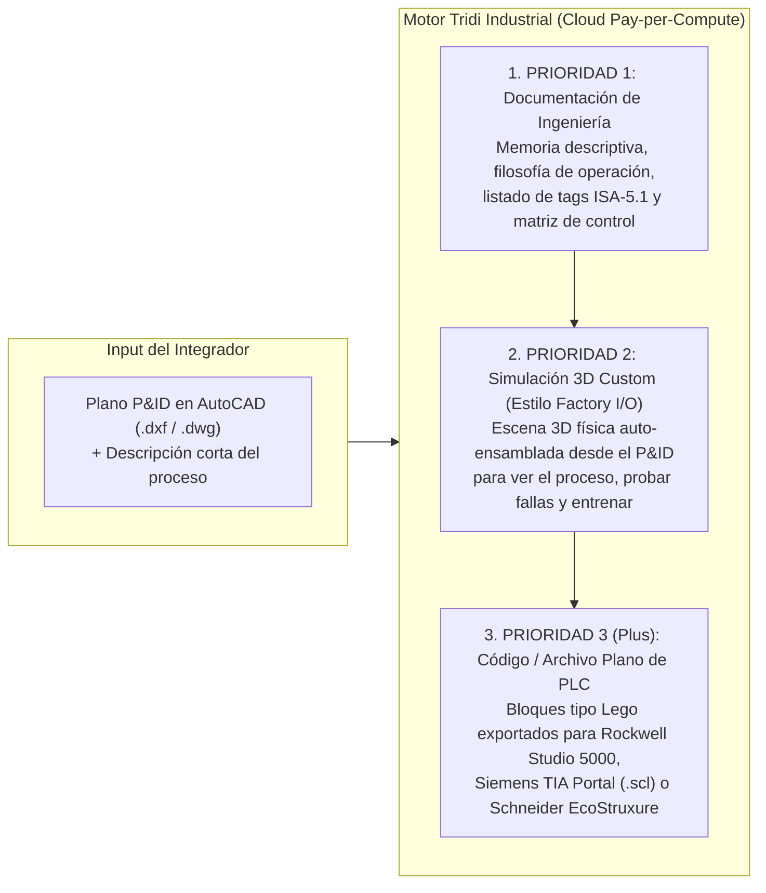
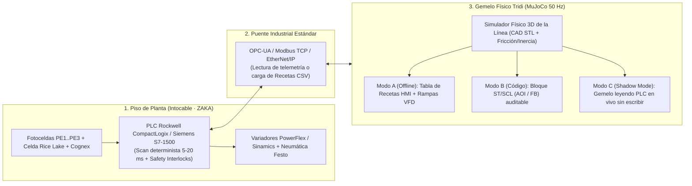

# Reunión Industrial — Ing. José González (ZAKA, C.A.): Preparación, Resultados y Plan de Acción

> **Fecha:** 12 de noviembre de 2026 · Barquisimeto (2 horas de sesión grabada y transcrita)  
> **Con quién:** **Ing. José González** (Fundador y Director de **ZAKA, C.A.**, [`zakasys.com`](https://zakasys.com), Ingeniero en Computación UFT con casi 30 años automatizando plantas en Venezuela, representante/integrador de **Rockwell Automation**, papá de José Miguel).  
> **Estado:** ✅ **Reunión realizada con éxito.** Próximo paso: investigar y construir 100 % de nuestro lado el estándar de documentación **ISA (`isa.org`)** + prototipo `P&ID (.dxf) → Docs + Simulación 3D + PLC` para mostrárselo funcionando.

---

## 0. Resultados Reales de la Reunión (12 de noviembre de 2026) y Plan de Producto Industrial

### A. Cómo nos fue y qué validamos en las 2 horas de sesión
1. **Receptividad total y validación del motor visual/físico:**  
   El Ing. José González nos dio una clase magistral desde cero sobre cómo funciona la automatización industrial real en Venezuela y el mundo (procesos continuos vs. discontinuos/por lotes, pirámide ISA niveles 0–4: Campo → PLC → SCADA → MES → ERP + capa consumidor/Industria 4.0, y convergencia OT/IT). Cuando le mostramos lo que construimos en Tridi —el caso físico de Luigi y la simulación de la celda industrial (`factory_cell`)—, **le gustó mucho, lo entendió de inmediato y vio totalmente factible aplicar redes neuronales y simulación física en su flujo de trabajo**.
2. **El verdadero cuello de botella de un integrador industrial hoy (meses antes de tirar código):**  
   Nos mostró un proyecto real que está trabajando ahora mismo (línea de silos de Harina PAN con **22 silos**, tamizadores, tornillos sin fin y **6 máquinas empaquetadoras** aguas abajo). Nos explicó que **llevan semanas/meses en ingeniería conceptual y básica armando la documentación y el diseño antes de escribir la primera línea de código del PLC**.
3. **Su herramienta interna ("Zakasita") y cómo programa un experto:**  
   Nos reveló que él usa una estructura propia de bloques modulares tipo "Lego" (librerías pre-armadas para cada motor, cilindro o válvula: bloque de arranque, parada, estatus encendido/apagado, alarma de falla y horómetro de mantenimiento) y que en **Rockwell (`Studio 5000`)** él **exporta e importa los programas como archivos de texto plano** que se pueden editar en frío y volver a cargar al controlador (`ControlLogix`).
4. **Venezuela como mercado de validación industrial:**  
   Confirmó un dato clave: a diferencia de otros países de LatAm (donde una planta deja un PLC de los años 80 por 40 años mientras prenda), **las plantas grandes en Venezuela (Polar, Nestlé, PepsiCo, Farmatodo, alimentos, petróleo y gas) sí invierten activamente contra la obsolescencia tecnológica** para evitar paradas de planta catastróficas, y Barquisimeto históricamente funciona como ciudad piloto de pruebas en el país.

---

### B. El Producto Exacto que le Sirve al Ing. José González (En Orden Estricto de Prioridad)

El Ing. José definió con precisión quirúrgica qué herramienta en la nube usaría él —y miles de integradores en Venezuela, Colombia, Chile y el mundo— a partir de un único input estándar: el archivo **P&ID (*Piping & Instrumentation Diagram* / Diagrama de Tuberías e Instrumentación)** exportado de AutoCAD (`.dxf` / `.dwg`) más una descripción breve del objetivo del proceso:



1. **Prioridad 1 — De archivo P&ID (`.dxf` / `.dwg`) a Documentación Completa de Implementación (`ISA-5.1` / `ISA-88`):**
   - Todo proyecto industrial arranca por un plano **P&ID** normado por la **ISA (*International Society of Automation*, [`isa.org`](https://www.isa.org))**. Un tornillo sin fin, una válvula, un tanque o un switch de nivel (`LSH`) se dibujan y codifican igual en Barquisimeto que en Pekín.
   - El archivo `.dxf` de AutoCAD es texto estructurado muy fácil de parsear.
   - **Qué debe entregar Tridi primero:** Leer el P&ID y generar automáticamente el documento formal de ingeniería de automatización (descripción paso a paso del proceso en lenguaje técnico humano, filosofía de operación, inventario de sensores/actuadores y qué representa cada línea de control). Cada corporación (Polar, Nestlé, PDVSA) tiene su plantilla con copyright, pero todas parten de la base **ISA (`ISA-5.1` / `ISA-88`)**. **No dependemos de que nadie nos pase plantillas:** armamos nuestra propia plantilla maestra estandarizada basada directamente en las normas públicas de `isa.org` para llegar a mostrarle el resultado ya listo.
2. **Prioridad 2 — Simulación Visual y Física 3D Auto-Generada (Tipo *Factory I/O*, pero Custom desde el P&ID):**
   - Él usa *Factory I/O* para simular entradas/salidas de Nivel 0 conectadas al controlador antes de ir a producción, pero hoy hay que armar la escena a mano y escribir el código uno mismo.
   - **Qué debe hacer Tridi:** Al subir el P&ID, levantar automáticamente el mundo 3D interactivo del proceso (tanques, silos, válvulas, bombas, bandas, sensores) en el navegador, tanto para que el ingeniero **vea visualmente su planta funcionando y pruebe fallos** (ej. válvula trancada, motor vencido, combinaciones de $22 \times 22$ silos) como para que la red neuronal optimice la secuencia en nanosegundos.
3. **Prioridad 3 (El Plus Hiper Genial) — Entrega del Archivo Final Instalable en el PLC:**
   - Una vez validada la documentación y la simulación 3D, exportar el archivo plano o código estructurado listo para abrir y cargar en el PLC según la marca que elija el integrador:
     - **Rockwell Automation:** Archivo plano de `Studio 5000` (`.L5K` / `.L5X` / texto estructurado para `ControlLogix` / `CompactLogix`).
     - **Siemens:** Bloques `.scl` / `TIA Portal` o `Logo!Soft Comfort` para relés programables en procesos simples.
     - **Schneider Electric:** `EcoStruxure`.
   - Además, mencionó una vertical de altísimo valor que él mismo acaba de probar en pozos petroleros del Lago de Maracaibo (bombas electrosumergibles donde una parada no detectada hace perder el pozo): **extracción de telemetría del PLC vía `MQTT` hacia un broker en la nube y mantenimiento predictivo** (como el unicornio brasileño **Tractian**, que detecta fallas en motores por vibración/sonido y dispara la orden de compra al ERP 12 semanas antes de que se dañe el repuesto).

---

### C. Reglas de Oro y Consejos Directos del Ing. José González para el Equipo

- **100 % en Inglés Técnico:** Nos recalcó estudiar, buscar papers, bajar normas de `isa.org` y entrenar los modelos **exclusivamente en inglés técnico industrial** (en español la terminología varía por país y confunde tanto a los ingenieros como a los LLMs).
- **Fuente madre:** **`www.isa.org`** (*International Society of Automation*) y canales/foros técnicos de P&ID y automatización en YouTube (preferir expositores que usen terminología estándar ISA).
- **Ir de menos a más (Cero *slop*):** No intentar simular una refinería el día 1. Empezar bajando planos P&ID libres en `.dxf` de procesos sencillos (ej. un tanque mezclador tipo Toddy con 3 válvulas de entrada, balanza de peso, motor agitador y válvula de descarga), lograr que el desglose del `.dxf` → Documentación ISA → Simulación 3D funcione sin fisuras, y mostrárselo funcionando de verdad.
- **Cliente objetivo y modelo de cobro:**
  - **Primer cliente meta:** **Integradores de automatización** y **empresas normalizadas** que trabajen bajo estándares ISA (descartar talleres informales que dibujan sin norma porque no son clientes ni pagan software).
  - **Modelo de negocio recomendado por él:** **SaaS en la nube *Pay-per-Compute* (pago por uso / cómputo por proyecto subido)** en lugar de licencias tradicionales caras de escritorio. Que cualquier integrador en Venezuela, Colombia o Chile entre a un link, suba su `.dxf`, pague por el cómputo (tarjeta / PayPal / Cashea localmente) y reciba su ingeniería, simulación y código.

---

### D. Cruce Tecnológico con `mus3o` (Ganador Platanus Hack 26) y Estrategia Tridi (YC W27 + Casa 212)

1. **Qué aprendemos del repo de `mus3o` (`~/Code/platanus-hack-26-ve-team-5`) para construir el generador 3D de plantas:**
   - Pastor propuso analizar cómo `mus3o` genera mundos 3D interactivos desde archivos subidos. Revisando su arquitectura (`docs/arquitectura.md` y `docs/diorama.md`), su secreto es el principio **"La IA razona y el código ensambla"**:
     - **Nunca pedirle a la IA que genere geometría 3D ni JSONs gigantes:** En `mus3o`, el LLM emite un **Micro-DSL de bajo consumo de tokens (~1.800 tokens, ahorro del 84 %)** eligiendo únicamente piezas de un **catálogo cerrado de assets 3D** y armando un grafo dirigido (DAG), validado con esquemas estrictos (`Zod` con `.catch()` para que un dato inválido jamás tumbe la escena 3D).
     - **Trazabilidad mecánica contra el documento fuente (`verifySources`):** Cada objeto 3D en `mus3o` cita la línea exacta del documento original del usuario, verificada por código.
   - **Cómo lo aplicamos en `Tridi Industrial` (`P&ID .dxf → Docs + 3D Sim + PLC`):**
     - **Paso 1 (Parser `.dxf` determinista):** Leemos las entidades `INSERT` (bloques de símbolos ISA), `LWPOLYLINE` (tuberías/líneas de señal) y `TEXT/MTEXT` (tags `FV-101`, `LT-102`, `M-101`) directo del archivo `.dxf`.
     - **Paso 2 (Industrial Low-Token DSL + Verificación ISA-5.1):** El modelo traduce el grafo del P&ID a un DSL industrial compacto (`UNIT`, `VESSEL`, `VALVE`, `ACTUATOR`, `SENSOR`, `PIPE_EDGE`, `STEP_SEQ`) donde cada ítem está anclado al tag exacto del plano `.dxf` (cero alucinaciones).
     - **Paso 3 (Ensamblaje determinista triple):** A partir de ese mismo DSL validado, el código de Tridi genera: (1) el documento de ingeniería ISA en Markdown/PDF, (2) la escena 3D interactiva en MuJoCo + Three.js instanciando nuestro catálogo cerrado de componentes industriales (`physics/components/`), y (3) el bloque de código PLC (`.scl` / `.L5X`).
2. **Estrategia de Compañía (Dualidad Humanoides + Plantas Industriales, YC y Casa 212):**
   - **No matamos Humanoides:** Tridi mantiene su visión grande para **Y Combinator** (respuesta del batch W27 antes del **11 de diciembre de 2026**, más los **4 batches trimestrales de 2027**, y aplicación a **Casa 212 de Vicente Zavarce en diciembre de 2026**).
   - **Posicionamiento Corporativo Dual en `trytridi.com`:**
     - **Tridi for Humanoid Robots:** Entrenamiento de humanoides (`Unitree G1 / H1`) a partir de video humano y simulación física masiva.
     - **Tridi for Industrial Plants:** De planos P&ID y CAD a documentación ISA, simulación física 3D tipo *Factory I/O* y código de PLC/MCU para monetizar de inmediato en la industria real de Venezuela y Latinoamérica.

---

## 1. Quién es ZAKA, C.A. y en qué mundo se mueven (Preparación Pre-Reunión)

- **22 años en piso de planta (desde 2004):** Empezaron en Calabozo (Guárico) y operan desde **Calabozo y Barquisimeto**. Su filosofía escrita en su web es: *"La Industria 4.0 no empieza en la nube. Empieza en el piso de planta. No se puede optimizar lo que no se mide, ni medir lo que no está conectado."*
- **Su promesa principal como empresa:** **"Modernizar líneas sin detener la planta, trabajando en ventanas de parada reales."**
- **Las tecnologías que usan todos los días:**
  - **Rockwell Automation (Allen-Bradley):** Son *Bronze System Integrator* oficial (`Studio 5000`, `ControlLogix`, `CompactLogix`, `FactoryTalk View`, variadores `PowerFlex 525/700`, servos `Kinetix`).
  - **Siemens:** Integran `TIA Portal`, `S7-1200 / S7-1500`, `WinCC` y variadores `Sinamics`.
  - **AVEVA (Wonderware):** Son *Registered System Integrator* (`InTouch`, `System Platform`, `Historian`).
  - **Instrumentación y campo:** Sensores Endress+Hauser, visión artificial **Cognex**, neumática **Festo** y pesaje Rice Lake.
- **Sus 2 verticales fuertes en Venezuela:**
  1. **Alimentos, Bebidas y Empaque:** Dosificación por lotes (**ISA-88**) y líneas de envasado, empaquetadoras y fin de línea bajo el estándar industrial **PackML** (`ISA-TR88.00.02`), con cambios de formato parametrizados desde el HMI.
  2. **Petróleo, Gas, Plásticos y Cemento:** Retrofits de maquinaria pesada (ej. extrusoras con controladores obsoletos sin planos originales), migración de PLCs viejos y tableros de control de motores (CCM).

---

## 1.5 Diccionario Rápido de Planta para Todo el Equipo (Traducido a lo que ya construimos en Tridi) + Videos

Para que todo el equipo (**Ale, Pastor, Juan y César**) vaya con la película clara hoy: **el 90 % de los conceptos de automatización industrial son equivalentes directos de lo que ya programamos en Tridi**, solo que en planta tienen otros nombres.

### A. Traducción directa: de nuestro código al lenguaje del Sr. José

| Concepto en Planta (ZAKA) | Qué es en sencillo (Nuestro mundo en Tridi) | Cómo lo resuelve lo que ya construimos |
| --- | --- | --- |
| **PLC (`Siemens S7-1200/1500`, `Rockwell CompactLogix`)** | Es literalmente un **microcontrolador industrial blindado a 24 V** montado en un gabinete que corre un ciclo fijo (`scan time` de `5–20 ms`) leyendo sensores (`true/false`) y activando motores o válvulas neumáticas. | Nuestro compilador [`training/export_mcu.py`](../training/export_mcu.py) ya genera lazos de control deterministas de `20 ms` (`50 Hz`) sin bloqueos ni memoria dinámica. |
| **Texto Estructurado (`SCL` / `ST` — `IEC 61131-3`) y Bloques `AOI` / `FB`** | Es el lenguaje moderno de programación de PLCs. En vez de diagramas eléctricos viejos (*Ladder*), es código idéntico a TypeScript/C (`IF sensor THEN motor := 50.0; END_IF;`) empaquetado como una función reutilizable (`FB` en Siemens / `AOI` en Rockwell). | En vez de exportar solo `.h` de C para Arduino, el compilador de Tridi exporta un bloque `.scl` auditable que los ingenieros de ZAKA pegan en `TIA Portal` o `Studio 5000`. |
| **Variador de Frecuencia (`VFD` — `PowerFlex` / `Sinamics`) y Rampas** | En el robot de Luigi usamos un puente H (`L298N`) con `PWM` (`0..255`) para regular motores DC. En fábrica los motores son trifásicos AC grandes, y el **VFD** regula su velocidad subiendo o bajando la frecuencia eléctrica (`0 Hz` a `60 Hz`). La **rampa (`Accel / Decel Time`)** son los segundos que tarda en subir de `0` a `50 Hz` para no partir ejes viejos ni patinar la banda por un tirón brusco. | En MuJoCo modelamos la masa real, fricción y juego mecánico de la máquina, probamos distintas rampas (`0,24 s`, `0,35 s`, `0,52 s`) y entregamos el número exacto antes de energizar el motor en planta. |
| **HMI (`FactoryTalk View` / `WinCC` / `InTouch`) y "Recetas de Formato" (`ISA-88` / `PackML`)** | El **HMI** es la pantalla táctil pegada al tablero de la máquina donde el operador elige qué producto va a correr hoy (`Formato 250 g`, `500 g` o `1 kg`). La **receta** es la tabla de números (`Hz` de cinta, `mm` de pistón, `ms` de prensa) que se le envía al PLC al cambiar de envase. | Igual que en [`trytridi.com/#/delivery`](https://trytridi.com/#/delivery) probamos 32 episodios variando masa y fricción, en [`trytridi.com/#/simulations/factory_cell`](https://trytridi.com/#/simulations/factory_cell) simulamos cada formato de envase y exportamos la tabla de recetas pre-calibrada sin gastar horas ni aplastar cajas a ojo en la planta. |
| ***Virtual Commissioning* (Puesta en marcha virtual)** | Es probar el programa del PLC contra el modelo 3D de la máquina en la computadora **antes** del domingo de parada de planta. | En lugar de usar software corporativo de USD 30.000+ que requiere estaciones pesadas, Tridi levanta el gemelo físico en MuJoCo directo en el navegador a partir de los `.STL` y prueba casos extremos (patinaje de banda, fricción, sensores con retardo). |

### B. 5 Videos Cortos en YouTube (para ver a `1.5×` antes de la reunión)

1. **Cómo se ve un simulador 3D conectado a un PLC real (Factory I/O + Siemens TIA Portal):**
   - 🎥 [Simulación 3D con Factory I/O y TIA Portal (español)](https://www.youtube.com/watch?v=fOZVj-tRITw)
   - 🎥 [Ejemplo práctico de banda transportadora 3D + sensores + PLC](https://www.youtube.com/watch?v=NO9WiTH9PLk)
   - *Por qué verlo:* Muestra exactamente una cinta con fotoceldas y pistones como nuestro `factory_cell`. La diferencia clave es que los simuladores clásicos de PLC son casi "cinemáticos" (cajas ideales), mientras que **MuJoCo en Tridi simula física de contacto real, patinaje, fricción variable e inercia en la web**.
2. **Qué es un Variador de Frecuencia (VFD) y por qué importan las rampas de aceleración:**
   - 🎥 [Variadores de Frecuencia explicados fácilmente](https://www.youtube.com/watch?v=Ry10hneiET4)
   - 🎥 [Rampas de aceleración y desaceleración en un variador](https://www.youtube.com/watch?v=Ul_O3oaz3cw)
   - *Por qué verlo:* En los primeros 3 minutos queda clarísimo qué son los `Hz` y los segundos de rampa (`0,24 s`, `0,35 s`, `0,52 s`) que calculamos en `factory_cell`.
3. **Qué es *Virtual Commissioning* con CAD mecánico real (Siemens NX MCD + PLC):**
   - 🎥 [Virtual Commissioning: CAD 3D + PLC Simulation](https://www.youtube.com/watch?v=ZvrE2IfrfgI)
   - *Por qué verlo:* Muestra cómo la gran industria conecta el CAD 3D con el PLC para validar una máquina antes de fabricarla o modernizarla.

> **Actitud clave para todo el equipo:** Ninguno de nosotros tiene que fingir que lleva 20 años programando PLCs Siemens — ese es el orgullo y el terreno del Sr. José. Nuestra fortaleza frente a él es: *"Sr. José, nosotros dominamos el motor de física 3D (`MuJoCo`), visión e IA; queremos que usted nos diga cómo le entregamos esos parámetros, tablas de recetas o bloques de código para que a los ingenieros de ZAKA les ahorre horas reales en planta."*

---

## 2. Nuestra Postura: Aliados y Generación de Relevo (Cero Competencia)

> [!IMPORTANT]
> **Regla de oro del equipo (Ale + Pastor + Juan + César):**  
> El Sr. José recibe a Ale con muchísimo cariño personal, pero nunca han hablado de trabajo. El peor error sería sonar a que "4 chamos con IA vienen a reemplazar los PLCs o a quitarle chamba a ZAKA".  
> **La postura exacta:**
> - **Quien diseña, vende y monta la automatización en la planta es ZAKA.** Ellos tienen 22 años de reputación, certificaciones y acceso a las plantas.
> - **Qué es Tridi para ZAKA:** Nosotros no montamos tableros ni vendemos servicios de planta. Somos un equipo joven dedicado a **simulación física 3D (`MuJoCo`) e IA aplicada a control**, que busca ser el **aliado de software de ZAKA** (su banco de pruebas virtual / gemelo digital antes de ir a la parada de planta).

### Qué NO hacer en la reunión
1. **Jamás decir que Tridi "automatiza las maniobras manuales del operador" por su cuenta.** Ese es el negocio de ZAKA. Si una planta necesita automatizar una línea, la automatiza ZAKA; Tridi es el simulador 3D para los ingenieros de ZAKA.
2. **Jamás decir que "la IA reemplaza al PLC"** ni presentar el botón de falla de la celda industrial como "miren cómo fallan los PLCs". En una planta real, el PLC (`Rockwell` / `Siemens`) y las seguridades eléctricas son sagrados.
3. **No hablar en jerga académica de IA (`PPO`, `domain randomization`, `reward`).** Hablar en idioma de planta: **gemelo físico, simulación de fricción y patinaje, pruebas antes de la ventana de parada (*virtual commissioning*), recetas de formato y cero merma**.

### Cómo entra aquí la tesis de Elon Musk (Optimus y fábricas, feb 2026)
En la entrevista que transcribimos ([`yc/investigacion/voces/2026-02-elon-musk-optimus.md`](../yc/investigacion/voces/2026-02-elon-musk-optimus.md)), Elon resume el problema real de la robótica física hoy en dos puntos que conectan directo con el Sr. José:
- **El cuello de botella ya no es el hardware, es el *Sim-to-Real*:** Una cosa es el código en vacío y otra muy distinta cuando el motor enfrenta fricción real, desgaste mecánico, cajas que resbalan o sensores con retardo. Para resolverlo sin romper equipos en vivo hace falta un **simulador físicamente exacto**.
- **Dónde da retorno primero:** En **operaciones continuas 24/7 dentro de fábricas**, donde cada minuto de parada o cada caja aplastada cuesta plata real.

---

## 3. Cómo Abrir la Conversación y Qué Mostrar en Pantalla (3 minutos)

### Paso 1 — El Pitch corto de Tridi y la historia de Luigi (1 min)
- **Cómo contarlo:**
  > *"Sr. José, Tridi nació hace tres semanas en la Platanus Hack en Caracas y con esto aplicamos a Y Combinator. Empezamos convirtiendo videos en movimientos físicos para robots humanoides en MuJoCo. Pero al volver a Barquisimeto quisimos probar el mismo motor de física con hardware real que tuviéramos en la mano, y nos sentamos con Luigi D'Aquaro y su robot explorador."*
- **Mostrar en pantalla [`trytridi.com/#/milestones`](https://trytridi.com/#/milestones) y [`#/simulations/luigi_lab4`](https://trytridi.com/#/simulations/luigi_lab4):**
  - Mostrar cómo agarramos las piezas CAD (`.stl`) y el código Arduino de su robot, armamos su gemelo físico en MuJoCo y destapamos los 3 problemas reales por los que chocaba en el piso:
    1. **Fricción real:** Las llantas de TPU tenían zona muerta y no se movían con `PWM < 115`.
    2. **Bloqueo de código:** `pulseIn()` en el sensor ultrasónico congelaba el procesador por **`47,1 ms`** cuando no había eco.
    3. **Sensor apagado en silencio:** El sensor óptico era un lote alternativo (`Chip ID 0x9E`) y la librería oficial lo rechazaba.
  - Con el simulador y nuestro compilador a C (`50 Hz`, sin bloqueos), el robot físico salió andando y esquivando todo en la sala a la primera.

### Paso 2 — La Línea Industrial de 4 Estaciones en MuJoCo (2 min)
- **Mostrar en pantalla [`trytridi.com/#/simulations/factory_cell`](https://trytridi.com/#/simulations/factory_cell):**
  - Construimos una línea **PackML / ISA-88 de 4 estaciones** inspirada directamente en el catálogo de integraciones de ZAKA:
    1. **Estación 1 — Dosificación y Pesaje Dinámico (`PE-01` en `x = -0,38 m`):** Tolva de entrada inoxidable, plataforma de celda de carga tipo *Rice Lake* y primera barrera fotocelda emisora/receptora.
    2. **Estación 2 — Alineación Neumática y Visión (`x = -0,08 m`):** Cilindro neumático lateral tipo *Festo* con manifold y cámara cenital tipo *Cognex In-Sight* con anillo de iluminación.
    3. **Estación 3 — Prensa Termoselladora / Tapadora + Torre Andon (`PE-02` en `x = +0,10 m`):** Pórtico industrial con actuador vertical, semáforo de estado `PackML` (`Verde / Ámbar / Rojo`) y barrera óptica de confirmación de posición antes del descenso.
    4. **Estación 4 — Rampa de Descarga, Paletizado y Gabinete NEMA 12 (`PE-03` en `x = +0,52..1,18 m`):** Rampa de salida hacia Euro-Palet con lotes apilados y tablero de control lateral (`PLC Rockwell / Siemens` + variador `VFD` + pantalla `HMI` + paro de emergencia).
  - **Qué demostrar en vivo con los botones del panel derecho:**
    - **Cambio de Formato HMI (`250 g` / `500 g` / `1 kg`):** Al cambiar el formato en pantalla, cambia la geometría e inercia de la caja en 3D y el simulador escupe al instante la **receta pre-calibrada para el PLC** (`VFD Hz`, `Rampa de aceleración en s`, `Carrera de pistón en mm`, `Profundidad de prensa en mm` y `Tiempo de sellado Dwell en ms`).
    - **Stress-Test de Patinaje de Banda (`28 %` de desgaste mecánico):** Mostrar cómo un programa de PLC por timer fijo aplasta el envase cuando la banda patina, mientras que el lazo cerrado validado en MuJoCo compensa el retardo esperando la confirmación física de `PE-02` (`0 %` de merma).
  - **Hacerle la pregunta abierta de frente:**
    > *"Usted que monta líneas PackML de verdad desde hace 22 años: ¿cómo ve esto? ¿Dónde sí tiene sentido algo así en las plantas de acá y dónde estamos pelando bola?"*

---

## 4. Qué Validar con el Sr. José (Las 3 Hipótesis de Planta + Los 4 Cruces Técnicos a Fondo)

### A. Las 3 Hipótesis de Dolor en Planta (Pastor)

1. **Hipótesis 1 — Puesta en marcha y ventanas de parada (*Virtual Commissioning*):**  
   Cuando ellos modernizan una línea de empaque o montan un PLC nuevo trabajando contra reloj en una ventana de parada, ¿cuánto tiempo y plata se pierde hoy probando y ajustando tiempos, variadores, sensores y pistones directamente sobre la máquina el día de la parada de planta? ¿Un gemelo físico donde puedan simular el CAD de la línea antes de tocar la planta les ahorraría horas reales, o ya usan algo para eso?
2. **Hipótesis 2 — Merma y desincronización en líneas de empaque (`PackML`):**  
   En las empaquetadoras y envasadoras reales que ellos atienden en Venezuela, ¿qué es lo que más se traba o genera merma en el día a día? ¿Es un tema de tiempos fijos en el PLC cuando resbala la cinta o cambia el envase (como lo que armamos en `factory_cell`), o el dolor de ellos pasa por otro lado (sensores dañados, falta de repuestos, cuellos de botella mecánicos)?
3. **Hipótesis 3 — IA vs. PLC en industria real:**  
   En una planta de alimentos de verdad que usa Rockwell o Siemens, ¿hasta dónde dejarían entrar algo como Tridi? ¿Como simulador previo para calcular y entregar parámetros deterministas al PLC, o en qué tipo de máquinas sí verían viable meter control adaptativo o visión?

---

### B. Cruce Técnico a Fondo entre lo que Vende ZAKA (`/servicios` y `/clientes`) y Nuestro Repo (Juan)

#### 1. Servicio 06 de ZAKA (Retrofit de máquinas viejas) × `Tridi Assembler` (Modelado de Juego Mecánico y Rampas VFD)
- **El problema físico real en planta:** ZAKA hace retrofit de extrusoras de plástico, mezcladoras y empaquetadoras de los años 80/90 cuyos controladores murieron, donde ya no existen planos originales y los reductores/correas tienen desgaste (*backlash*, holgura mecánica y fricción asimétrica). Cuando se instala un variador moderno (`Allen-Bradley PowerFlex 525/753` o `Siemens Sinamics G120`), una rampa de aceleración/desaceleración muy agresiva genera picos de torque mecánico, golpe de ariete o resonancia que parte ejes o quema fusibles el día del arranque.
- **Cómo lo resuelve Tridi técnicamente:**
  - En MuJoCo modelamos la inercia rotacional reflejada al eje del motor ($J_{\text{eq}} = J_m + J_{\text{carga}} / i^2$), el coeficiente de fricción estática/viscosa (`damping`, `frictionloss`, `armature`) y el patinaje de banda.
  - Antes de energizar el tablero en planta, corremos un barrido de estrés en el gemelo físico y entregamos los parámetros exactos del variador:
    - **Tiempo de Rampa de Aceleración (`P041 Accel Time 1` en PowerFlex / `p1120` en Sinamics)** y **Curva S (`S-Curve %`)** que garantizan que el torque pico nunca supere el límite mecánico del eje viejo.
- **👉 Qué preguntarle al Sr. José:**
  > *"Cuando le cambian el PLC o meten variadores nuevos (`PowerFlex` / `Sinamics`) a una máquina vieja sin planos, ¿cómo calculan hoy las rampas y tiempos sin arriesgarse a golpear la transmisión en el arranque?"*

#### 2. "Cambios de formato parametrizados desde HMI" (`ISA-88` / `PackML`) × Nuestra Matriz de Escenarios (`#/delivery` + `factory_cell`)
- **El problema físico real en planta:** En su vertical de Alimentos y Bebidas, ZAKA implementa cambios de formato desde el HMI (`FactoryTalk View` / `WinCC` / `InTouch`) para que el operador cambie de `250 g` a `500 g` o `1 kg` sin reprogramar el PLC. Sin embargo, cada formato nuevo cambia el centro de masa, la fricción con las barandas y la inercia de frenado: afinar a ojo cada receta nueva en piso de planta consume horas de paro y cientos de envases perdidos en pruebas.
- **Cómo lo resuelve Tridi técnicamente:**
  - Exactamente igual que en [`trytridi.com/#/delivery`](https://trytridi.com/#/delivery) corremos una matriz de 32 episodios variando masa (`×0,80..×1,25`), fricción (`0,25..1,00`) y perturbaciones, Tridi simula los distintos formatos de envase en `factory_cell` y exporta la **Tabla de Recetas Deterministas (`UDT_Recipe_Format`)** lista para importar en `.CSV` o `OPC-UA` al HMI:

| Parámetro de Receta PLC / HMI (`UDT_FormatRecipe`) | Formato `250 g` (Alta vel.) | Formato `500 g` (Estándar) | Formato `1 kg` (Alta inercia) | Registro destino típico (`Rockwell` / `Siemens`) |
| --- | --- | --- | --- | --- |
| **Frecuencia Variador Cinta (`VFD_Freq_Hz`)** | `58,5 Hz` | `50,0 Hz` | `41,5 Hz` | `PowerFlex CmdFreq` / `Sinamics p1082` |
| **Rampa Aceleración / Frenado (`VFD_Ramp_s`)** | `0,24 s` | `0,35 s` | `0,52 s` | `P041/P042` / `p1120/p1121` |
| **Carrera Cilindro Alineador (`Pusher_Stroke_mm`)** | `155 mm` | `145 mm` | `132 mm` | `Festo Servo/Prop Valve Setpoint` |
| **Cota Prensa Selladora (`Sealer_Depth_mm`)** | `115 mm` | `138 mm` | `152 mm` | `Kinetix Axis Position` / `TO_PositioningAxis` |
| **Tiempo de Presión / Sellado (`Sealer_Dwell_ms`)** | `420 ms` | `550 ms` | `680 ms` | `TON_SealerDwell.PT` |
| **Ventana de Validación Óptica (`PE02_Debounce_ms`)** | `18 ms` | `25 ms` | `35 ms` | `TON_PE02_Confirm.PT` |

- **👉 Qué preguntarle al Sr. José:**
  > *"Cuando una planta mete un envase nuevo o cambia el gramaje, ¿cuánto tiempo y cuánta merma les toma hoy afinar en vivo la tabla de recetas del HMI para que no se caigan ni se aplasten los envases?"*

#### 3. El Puente Real entre Simulación y PLC × Evolución de Nuestro Compilador `J-3` (`training/export_mcu.py` → `IEC 61131-3 ST / SCL`)
- **El problema de ingeniería:** Ningún gerente de planta ni integrador serio va a meter una red neuronal `.onnx` como caja negra ni un script de Python con recolección de basura a comandar una prensa industrial de 80 N o un motor de 50 HP. El PLC requiere **tiempo de ciclo determinista (`scan time` de `2 ms` a `20 ms`), sin memoria dinámica, auditable línea por línea y con enclaves (*interlocks*) de seguridad cableados**.
- **Cómo lo resuelve Tridi técnicamente:**
  - En el Caso Luigi ([`docs/caso-luigi-sim2real.md`](caso-luigi-sim2real.md)) ya construimos [`training/export_mcu.py`](../training/export_mcu.py), que toma una política validada en MuJoCo y la transpila a **C99 estático (`461 bytes` de RAM, `< 0,4 ms` de ejecución, cero `malloc`)**.
  - Para integradores industriales como ZAKA, ese mismo compilador puede escupir un **Bloque de Función determinista en Texto Estructurado (`IEC 61131-3 Structured Text` — `SCL` en Siemens `TIA Portal` o `AOI` en Rockwell `Studio 5000`)**, donde la lógica validada en MuJoCo corre rodeada por un **Enclave de Seguridad Determinista (*Safety Wrapper*)**:

```iecst
(* Bloque generado por Tridi Compiler para Siemens TIA Portal (SCL) / Rockwell Studio 5000 (ST) *)
FUNCTION_BLOCK "FB_TridiPackML_Sealer"
VAR_INPUT
    xEStop_OK        : BOOL;   (* Enclave físico de parada de emergencia (Canal doble) *)
    xPE01_Entry      : BOOL;   (* Fotocelda entrada / pesaje (x = -380 mm) *)
    xPE02_SealerZone : BOOL;   (* Fotocelda confirmación zona prensa (x = +100 mm) *)
    xPE03_Exit       : BOOL;   (* Fotocelda salida a palet (x = +520 mm) *)
    rBeltPos_mm      : REAL;   (* Posición estimada por encoder / integrador VFD *)
    stRecipe         : "UDT_FormatRecipe"; (* Receta activa desde HMI: 250g / 500g / 1kg *)
END_VAR
VAR_OUTPUT
    rVFD_SpeedRef_Hz : REAL;   (* Consigna hacia PowerFlex 525 / Sinamics G120 *)
    rPusher_Ref_mm   : REAL;   (* Consigna cilindro alineador Festo *)
    rSealer_Ref_mm   : REAL;   (* Consigna prensa vertical *)
    ePackML_State    : INT;    (* 10=EXECUTE, 20=HOLDING, 30=HELD/FAULT *)
END_VAR
BEGIN
    (* 1. HARD SAFETY INTERLOCK: El PLC manda siempre sobre cualquier consigna *)
    IF NOT #xEStop_OK THEN
        #rVFD_SpeedRef_Hz := 0.0;
        #rPusher_Ref_mm   := 0.0;
        #rSealer_Ref_mm   := 0.0;
        #ePackML_State    := 30; (* PACKML_ABORTED / HELD *)
        RETURN;
    END_IF;

    (* 2. LAZO CERRADO VALIDADO EN MUJOCO: Compensa patinaje de banda esperando PE-02 *)
    IF #xPE02_SealerZone THEN
        #rVFD_SpeedRef_Hz := #stRecipe.VFD_Freq_Hz;
        #rPusher_Ref_mm   := #stRecipe.Pusher_Stroke_mm;
        #rSealer_Ref_mm   := #stRecipe.Sealer_Depth_mm;
        #ePackML_State    := 10; (* PACKML_EXECUTE_SEAL *)
    ELSE
        (* Si la banda patina, pre-alinea guías a 40 mm y retiene la prensa arriba (0 mm) *)
        #rVFD_SpeedRef_Hz := #stRecipe.VFD_Freq_Hz;
        #rPusher_Ref_mm   := 40.0;
        #rSealer_Ref_mm   := 0.0;
        #ePackML_State    := 10;
    END_IF;
END_FUNCTION_BLOCK
```

- **Arquitectura de Despliegue en 3 Niveles (Sin tocar la seguridad de la planta):**



- **👉 Qué preguntarle al Sr. José:**
  > *"Si el simulador de Tridi le entrega a los ingenieros de ZAKA la tabla de recetas pre-calibrada o un bloque `AOI` / `SCL` estándar que ellos mismos revisan y cargan en `Studio 5000` o `TIA Portal` — o corre en 'modo sombra' leyendo por `Modbus TCP` / `OPC-UA` sin tocar el control —, ¿eso calza limpio con las normas de las plantas acá?"*

#### 4. Fin de Línea Manual e Inspección Visual (Servicio 01 de ZAKA) × `Tridi Capture` (100 % como herramienta comercial y técnica para ZAKA)
- **El contexto:** En alimentos y empaque en Venezuela, el final de línea (encajonado manual, paletizado mixto, control de calidad visual con cámaras **Cognex**) suele ser donde más cuellos de botella y lesiones ergonómicas ocurren.
- **👉 Qué validar con él (posicionándolo siempre para que ZAKA venda más proyectos):**
  > *"Cuando ustedes visitan una planta para levantar un proyecto nuevo de fin de línea o inspección con cámaras Cognex, ¿les serviría grabar un video rápido de la operación actual y poder mostrarle al dueño de la planta una simulación física 3D de cómo va a quedar la celda automatizada por ZAKA antes de que les aprueben el presupuesto?"*

---

## 5. El Cierre Perfecto para Hoy (Sin venderle nada)

Preguntarle si en la oficina de ZAKA acá en Barquisimeto tienen algún **banco de pruebas / maqueta con PLC (`Allen-Bradley` o `Siemens`)**, o algún equipo real donde nos dejen ir una tarde con ellos a tomar medidas, conectarnos en modo lectura (`Modbus TCP` / `OPC-UA` / `Serial`) y armar juntos nuestro **primer caso de estudio industrial en [`trytridi.com/#/milestones`](https://trytridi.com/#/milestones)** — cero costo para ellos, dándole todo el crédito de ingeniería industrial a ZAKA y dejándoles el gemelo 3D listo para mostrar a sus clientes.
